# ESP32-S3 World & Space Clock (Kids Sleep Trainer + Adult Office Desk)

A high-craft, dual-core **ESPHome + LVGL 9** 800×480 digital clock, world day/night map, live ISS & seasonal tracker, and 4-phase circadian sleep trainer.

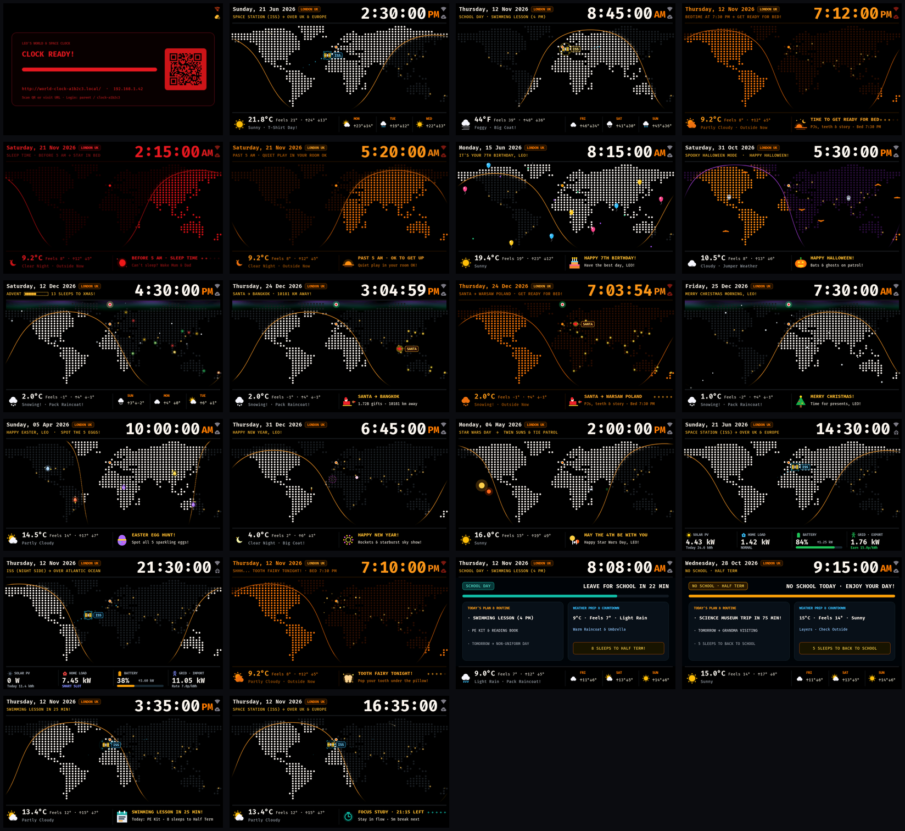

Available in **three plug-and-play flavours** from one modular codebase:
1. **Universal Standalone Kids & Teen Clock** (`examples/world-clock-standalone-release.yaml` / `examples/leo-clock-standalone.yaml`) — Zero Home Assistant needed! Core 0 background worker polls Open-Meteo, live ISS feeds, and optional **Apple iCloud / Google / School `.ics` calendars**, Google Public NTP, Captive Portal Wi-Fi setup with **sleep-safe red-on-black QR codes**, automatic per-device MAC hostname & login, runtime timezone selector, **Age & Visual Profiles (Ages 3–16+)**, **Focus Study Pomodoro timer**, and a full iPhone-friendly local Web UI.
2. **Home Assistant Kids & Teen Clock** (`examples/leo-clock-ha.yaml`) — Native encrypted ESPHome API with HA weather, ISS, **direct Core 0 `.ics` / `webcal://` calendar URLs right inside Home Assistant** (zero HA calendar integration needed — or optional HA calendar sensors), symmetric school-night bedtimes, Morning Launchpad, Focus Pomodoro, and 4-phase circadian dimming.
3. **Adult / Office Desk** (`examples/office-clock-energy-ha.yaml`) — Same live world map, solar terminator, night-side city lights & ISS tracker, with a **pluggable Band 3 dock** swapped out for live Home Assistant Solar / Load / Battery / Grid & Tariff telemetry (or any custom HA dock you build!).

**Parent & Gift Box Guides:**
- [**Parent Guide (`docs/PARENT_GUIDE.md`)**](docs/PARENT_GUIDE.md) — Plain-English guide to every setting, Apple iCloud / Google / School `.ics` calendars (Standalone & Home Assistant), Morning Launchpad, Multi-Event Priority Modes, Symmetric School-Night Bedtimes, Focus Pomodoro, Tooth Fairy mode, and iPhone OTA updates.
- [**Printable 1-Page Quick-Start Card (`docs/QUICK_START_CARD.md`)**](docs/QUICK_START_CARD.md) — Ready to print and pop inside a gift box!

---

## Visual Showcase

### 4-Phase Circadian Sleep Trainer
Each phase can be enabled/disabled and customized independently (times, brightness levels, and dynamic `{name}` / `{bedtime}` / `{quiet}` wording).

| Full 4-Phase Circadian Cycle (Animated) | Evening Wind-Down (Amber) |
| :---: | :---: |
| 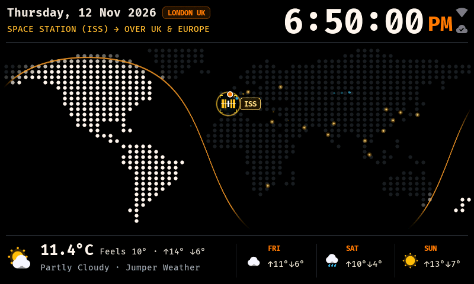 | 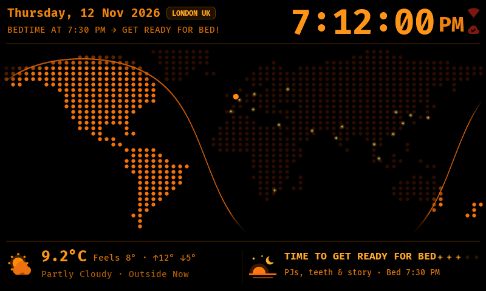 |

| Deep Sleep Mode (Red + Real Lunar Phase & 5 Stars) | Morning Quiet Play (Amber + Rising Sun) |
| :---: | :---: |
| 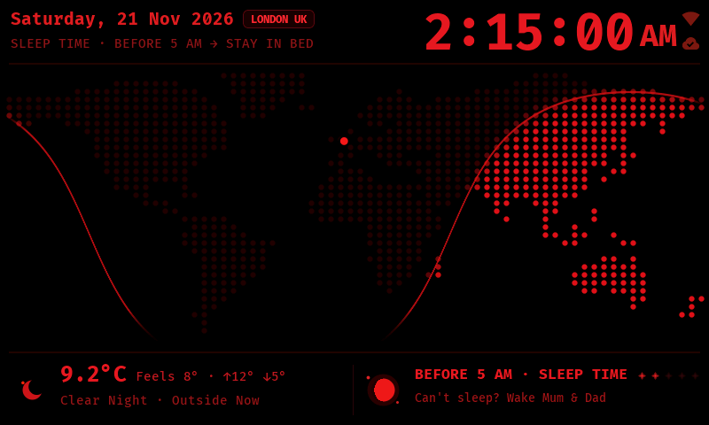 | 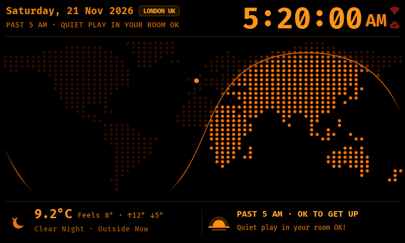 |

| Tooth Fairy Tonight! (One-Tap Wind-Down Magic) | Sleep-Safe Red QR Boot Setup & Auto-Identity |
| :---: | :---: |
| 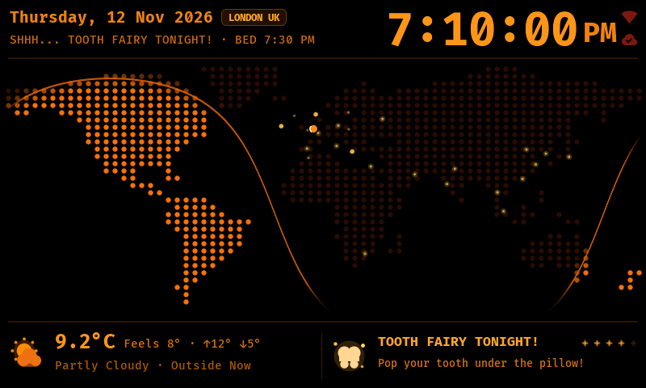 | 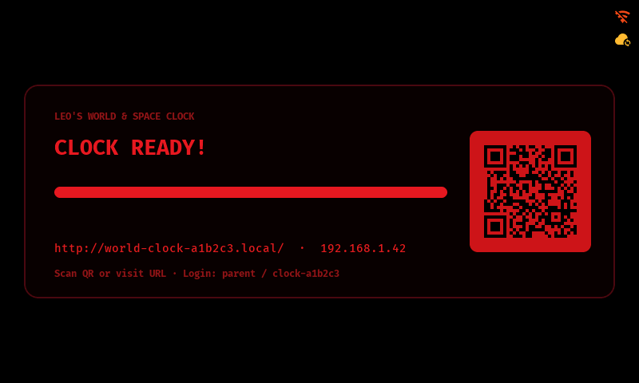 |

### Family & School Calendars, Morning Launchpad & Multi-Age Study Desk
Choose between **Subtle Ticker Only**, **Prominent Dock Card**, or **Morning Launchpad Takeover** (calm autism-friendly daily briefing with live Leave-for-School countdown, weather prep checklist, and automatic *"X SLEEPS TO HALF TERM!"* / *"X SLEEPS TO BACK TO SCHOOL"* badges), plus **Symmetric School-Night Bedtimes** (Friday/Saturday/pre-holiday late bedtime; Sunday night automatically reverts to early school-night bedtime!) and **Age & Visual Profiles (Ages 3–16+)** with a built-in **25m / 5m Focus Pomodoro Timer**:

| Calendar & Multi-Age Walkthrough (Animated) | Morning Launchpad — School Day & Leave Countdown |
| :---: | :---: |
| 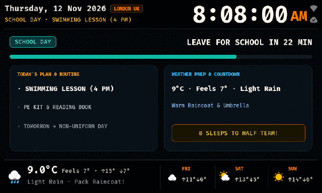 | 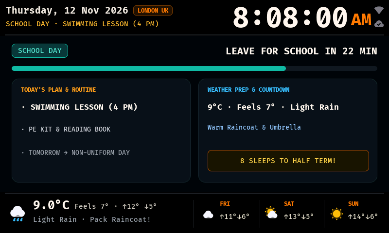 |

| Morning Launchpad — No-School Half Term & Back-to-School | Prominent Band 3 Calendar Dock Card (Imminent Countdown) |
| :---: | :---: |
| 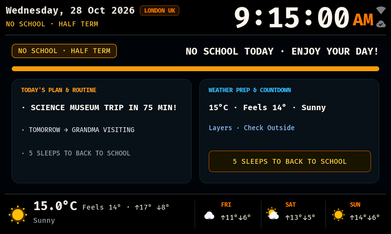 | 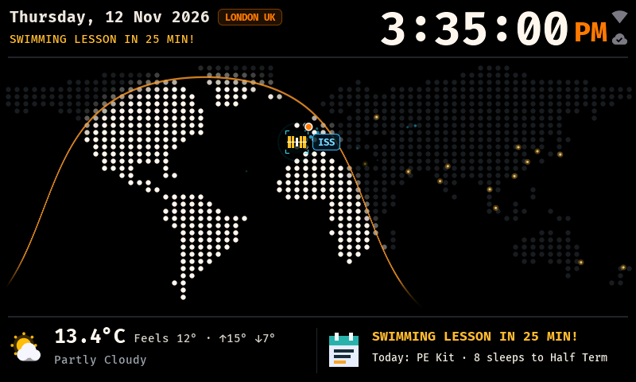 |

| Teen & Study Desk Profile (24h Clock + Focus Pomodoro) | Subtle Calendar Ticker + Fog Weather + Imperial (`°F`) |
| :---: | :---: |
| 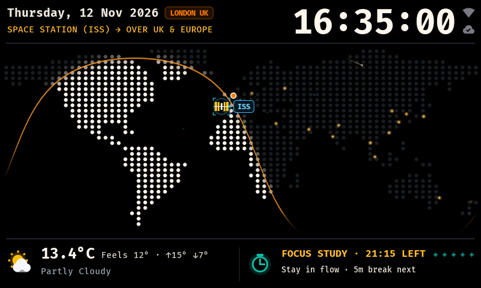 | 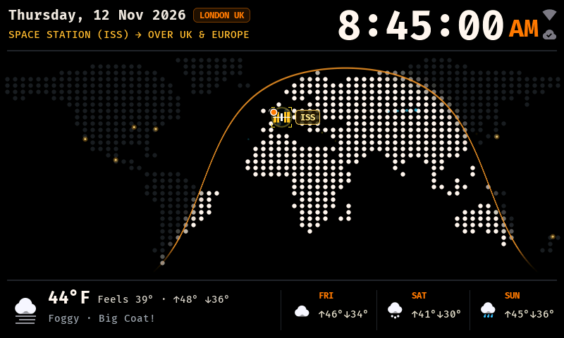 |

| Live ISS Orbit + Forward Projection & Night Lights |
| :---: |
| 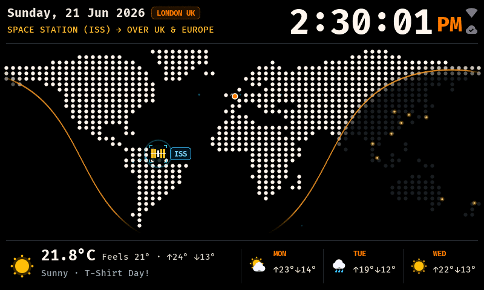 |

### Automatic Seasonal & Special Occasions (Live Animations)
Triggered automatically on the right dates (or previewed on-demand for 10 minutes before auto-reverting to `Auto`):

| Birthday Mode (Balloons & Age Counter) | Halloween (Drifting Ghosts & Bats) |
| :---: | :---: |
| 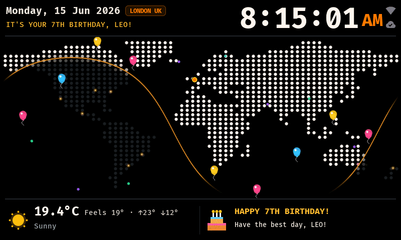 | 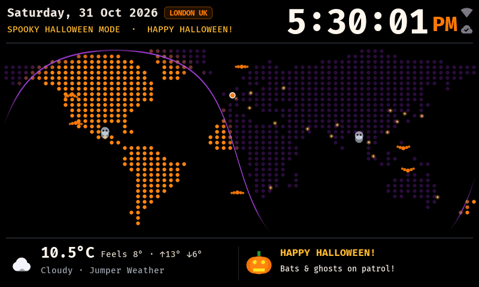 |

| Christmas Advent (Countdown Bar & Snow) | Christmas Eve Santa Tracker (30-City Route) |
| :---: | :---: |
| 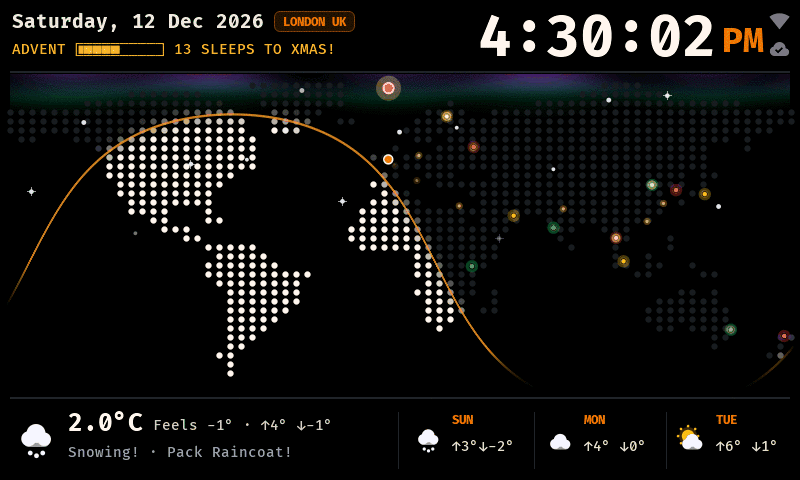 | 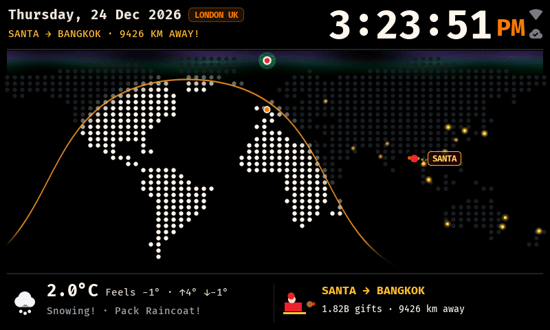 |

| Christmas Eve Wind-Down (Santa Keeps Flying!) | Christmas Day Morning |
| :---: | :---: |
| 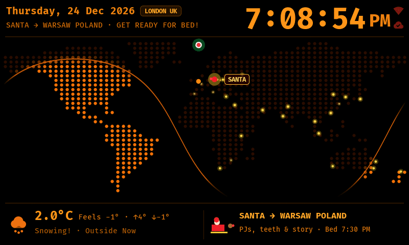 | 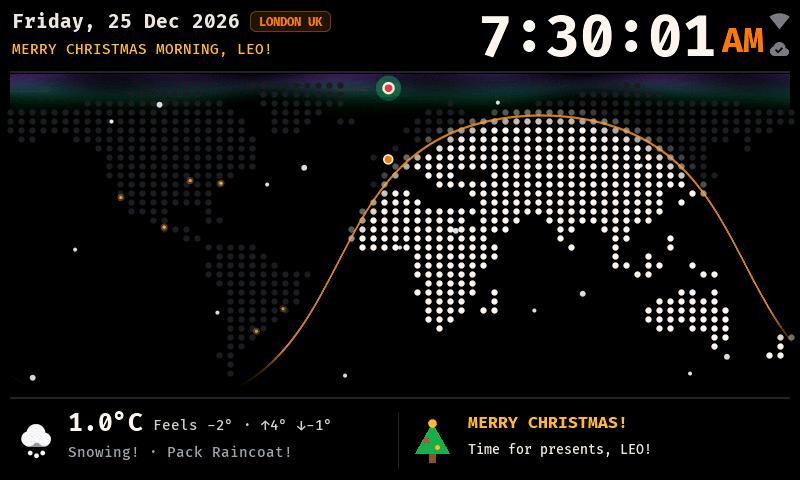 |

| Easter Egg Hunt (Exact Gregorian Easter) | Bonfire Night & New Year's Eve Fireworks |
| :---: | :---: |
| 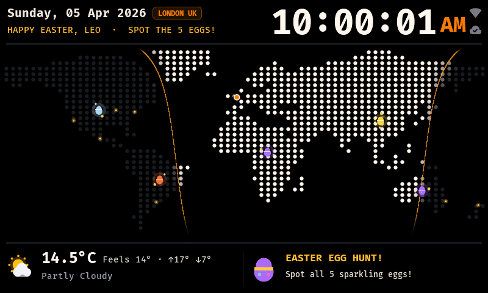 | 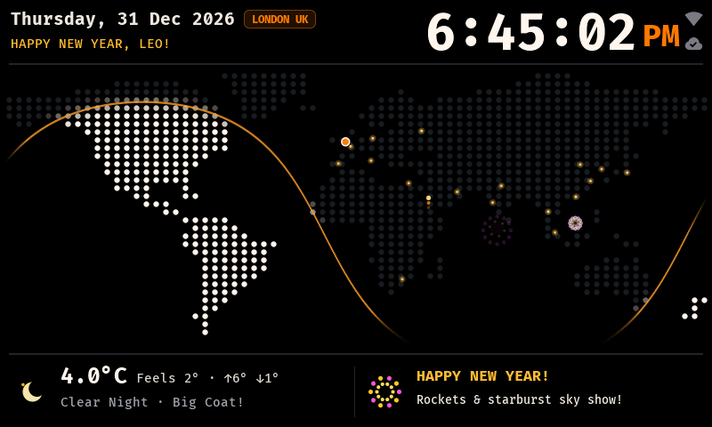 |

| Star Wars Day (May 4th — Twin Suns & TIE Patrol) |
| :---: |
| 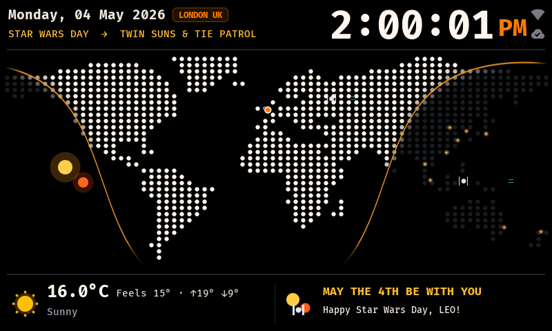 |

### Adult / Office Desk Edition (Pluggable Home Assistant Energy Dock)
Reuses Band 1 (Header) and Band 2 (World Map + Night City Lights + ISS), swapping Band 3 for a 4-tile live Home Assistant Solar, Home Load, Battery SoC & Grid/Tariff monitor:

| Daytime Solar Export | Off-Peak Smart Dispatch Slot |
| :---: | :---: |
| 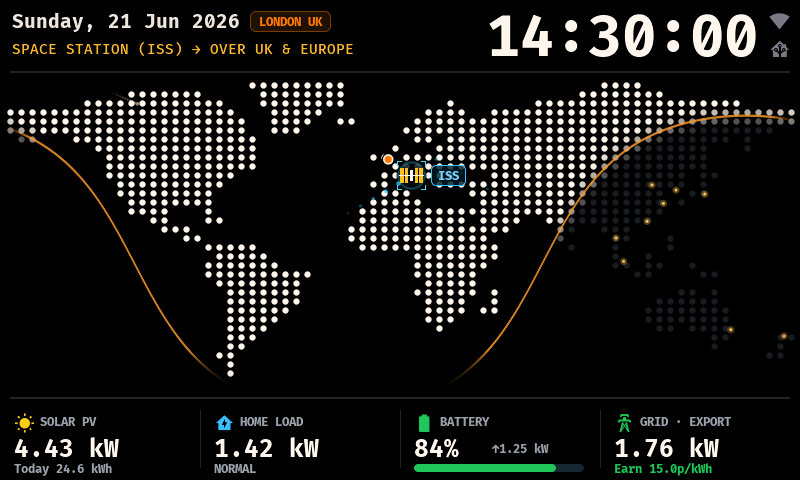 | 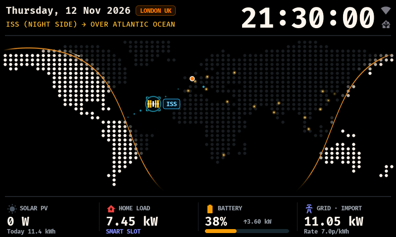 |

---

## Hardware & 3D-Printed Enclosure (USB-C / Non-Battery)

### Display Module
Built around the:
> **Guition ESP32-S3 8M PSRAM 16M FLASH 5-inch IPS 800×480 high-definition LCD display module with Wi-Fi and Bluetooth (without touch)** (`JC8048W550N`)

- Powered over standard **USB-C** (no LiPo battery required — safer for children's bedrooms).
- Tuned **19.5 kHz flicker-free PWM backlight** that boots gently at 15% (`ALWAYS_OFF` restore mode) so a midnight power cut never blasts daytime brightness into a sleeping bedroom.

### 3D-Printed Case & Stand
All case parts use the **non-battery, USB-C powered** variants:
1. **Front Cover (Custom Extended Bezel — included in this repo)**:
   - [`3d-models/front-cover-extended-bezel-v2.stl`](3d-models/front-cover-extended-bezel-v2.stl) — Custom-fitted extended bezel tailored specifically for the non-touch 5-inch IPS LCD module.
2. **Rear Enclosure (USB-C Hole Variant, non-battery)**:
   - [xTouch Pro USB Hole Variant on MakerWorld](https://makerworld.com/en/models/1127192-xtouch-pro-usb-hole-variant)
3. **Desk Stand / Base (non-battery variant)**:
   - [xTouch Pro Official Base for Guition 5-inch LCD on MakerWorld](https://makerworld.com/en/models/1016156-xtouch-pro-official-base-for-guition-5inch-lcd)

---

## Pre-Built Standalone Firmware (Zero ESPHome Install Required!)

Every tagged GitHub Release (`v*`) automatically builds and attaches universal pre-built firmware binaries from [`examples/world-clock-standalone-release.yaml`](examples/world-clock-standalone-release.yaml):

- **`world-clock-standalone-vX.Y.Z-factory.bin`** — First-time USB flash at offset `0x0` ([ESP Web Tools](https://web.esphome.io/) or `esptool.py`).
- **`world-clock-standalone-vX.Y.Z-ota.bin`** — One-click wireless update via the clock's Web UI (**OTA Update**). Preserves Wi-Fi, child's name, birth date, coordinates, sleep schedule, brightness, and custom wording automatically!

### Multi-Device Ready (Hardware MAC Auto-Identity)
Multiple clocks in the same household can run the exact same `.bin` without colliding:
- **Unique mDNS Hostname**: `http://world-clock-<mac6>.local/`
- **Unique Setup Wi-Fi Hotspot**: `world-clock-<mac6>` (password: `ClockSetup123`)
- **Unique Web Settings Login**: username `parent`, password `clock-<mac6>` (derived automatically from the board's last 6 hardware MAC hex characters)
- **Zero Setup Card Needed**: Unplug & plug in any clock to see its exact URL, IP address, and `parent / clock-<mac6>` login displayed on the 5-inch boot screen.

---

## Architecture

```text
├── 3d-models/
│   └── front-cover-extended-bezel-v2.stl  # Custom-fitted front cover STL (non-touch 5" LCD)
├── components/world_clock/       # Reusable C++ headers (auto-loaded locally OR via GitHub!)
│   ├── clock_math.h              # 4-phase schedule, lie-in, stars, UK occasions, lunar phase, TZ
│   ├── ics_parser.h              # Zero-allocation streaming RFC 5545 (.ics / webcal://) parser
│   ├── world_map.h               # Continent grid, terminator, night lights, aurora, PSRAM flush
│   ├── weather_dock.h            # Weather icons (incl. fog), lunar moon, 5 stars, Tooth Fairy
│   ├── sprite_engine.h           # 10fps dirty-rect sprites (ISS, Santa, fairy dust, shooting stars)
│   ├── net_worker.h              # Core 0 FreeRTOS HTTPS worker (Open-Meteo, ISS & .ics calendars)
│   └── sim_time.h / time.py      # Deterministic controllable clock for headless host emulation
├── packages/
│   ├── hardware_jc8048w550n.yaml # Board pins, PSRAM, 16-bit RGB LCD, 19.5kHz PWM backlight, OTA
│   ├── fonts.yaml                # Fira Code v6.2.0 + Material Design Icons
│   ├── ui_shell.yaml             # Band 1 (Header), Band 2 (Map), Top-Layer Splash + QR Code
│   ├── dock_weather.yaml         # Pluggable Band 3: Weather + 3-Day Forecast + Sleep/Holiday Cards
│   ├── dock_energy_ha.yaml       # Pluggable Band 3: 4-Tile Home Energy & Tariff Strip (HA)
│   ├── ha_weather_sensors.yaml   # HA weather entity bindings (pair with dock_weather.yaml)
│   ├── ha_calendar_sensors.yaml  # Optional HA Family & School Calendar entity bindings
│   ├── clock_core.yaml           # Shared globals, OTA splash, Shop Demo Mode, 10fps loop
│   ├── backend_homeassistant.yaml# HA API, time, ISS, overrides & 1Hz routine/schedule engine
│   └── backend_standalone.yaml   # Core 0 NetWorker, Google NTP, Captive Portal, QR & Web UI v3
├── examples/                     # Public, personal-info-free starter & universal release configs
├── sim/                          # Headless ESPHome host + SnapshotDisplay emulators (zero X11/SDL!)
├── scripts/run_emulator.py       # Compiles/runs emulators, builds PNG gallery & GIF/MP4 reels
├── docs/
│   ├── PARENT_GUIDE.md           # Full plain-English parent & iCloud/Google/School Calendar guide
│   ├── QUICK_START_CARD.md       # Printable 1-page gift-box quick-start card
│   └── media/                    # Web-ready PNG stills & optimized animated GIF previews
├── .github/workflows/            # CI (tests + firmware builds + emulator media) & Release builds
└── tests/test_clock_math.cpp     # Fast g++ unit tests for core C++ math
```

---

## Deploying to Your ESPHome Server (Zero Manual File Copying!)

Your ESPHome Device Builder (`http://<your-esphome-ip>:6052/`) can pull `packages/` and `components/world_clock/` **directly from GitHub** — you only paste a ~55-line device YAML into ESPHome!

In any device YAML on your ESPHome server, replace the local `external_components:` and `packages:` blocks with:

```yaml
external_components:
  - source:
      type: git
      url: https://github.com/YOUR_USER/esp32-world-clock
      ref: master
      path: components
    components: [world_clock]
    refresh: 1d

packages:
  world_clock:
    url: https://github.com/YOUR_USER/esp32-world-clock
    ref: master
    refresh: 1d
    files:
      - packages/hardware_jc8048w550n.yaml
      - packages/fonts.yaml
      - packages/ui_shell.yaml
      - packages/dock_weather.yaml        # Swap for packages/dock_energy_ha.yaml for Office Desk!
      - packages/ha_weather_sensors.yaml  # Only needed for HA + dock_weather.yaml
      - packages/clock_core.yaml
      - packages/backend_homeassistant.yaml  # Or packages/backend_standalone.yaml
```

*(Make sure your ESPHome server's `secrets.yaml` defines `wifi_ssid`, `wifi_password`, `ap_password`, and `api_key` or `web_auth_user`/`web_auth_pass`.)*

---

## Creating Your Own Custom Band 3 Dock

Any Band 3 dock (`y = 400..480`) only needs to:
1. Add its LVGL widgets under `lvgl: pages: - id: !extend main_page: widgets:`
2. Implement 3 scripts:
   - `render_dock` (full redraw on palette/mode change & every 5 min)
   - `apply_dock_palette` (update widget colors for `ui_palette` `0`=Day, `1`=Red, `2`=Amber)
   - `update_dock_1hz` (fast 1-second sensor/label updates)

See [`packages/dock_energy_ha.yaml`](packages/dock_energy_ha.yaml) for a complete, ready-to-copy example.

---

## Headless Emulator, Screenshots, Videos & CI

This repo includes a native **ESPHome `host:` + `SnapshotDisplay` headless emulator** (`sim/`) that runs the real LVGL 9.5 UI, fonts, world map, weather dock, energy dock, and 10fps sprite engine directly on Linux with zero display server or SDL2 required:

```bash
# Run C++ unit tests (4-phase schedule, Easter boundaries, lunar phase, UTF-8, JSON)
g++ -std=c++17 -Wall -Wextra -Werror -Icomponents/world_clock tests/test_clock_math.cpp -o /tmp/test_clock_math && /tmp/test_clock_math

# Run the headless emulator locally to capture all 22 mode PNGs, contact sheet & 12 animated mode videos
# (defaults to 30s per animated mode; pass --video-seconds 5 for fast local iteration or 60 for longer reels)
python3 scripts/run_emulator.py --out sim_output --video-seconds 30
```

### GitHub Actions Workflows
- **CI ([`.github/workflows/ci.yml`](.github/workflows/ci.yml))** — Runs on every push to `master`/`main` and every PR:
  1. C++ unit tests (`-Wall -Wextra -Werror`)
  2. Real ESP32-S3 firmware compilation across all 4 example/release configs (`leo-clock-standalone`, `world-clock-standalone-release`, `leo-clock-ha`, `office-clock-energy-ha`)
  3. Headless emulator run uploading all 22 PNGs, `overview_gallery.png`, 12 × 30-second H.264 MP4 videos, plus a combined `demo_reel.mp4` as workflow artifacts
- **Release ([`.github/workflows/release.yml`](.github/workflows/release.yml))** — Triggered on `git tag v1.0.0 && git push origin v1.0.0`: compiles the universal multi-device standalone firmware and attaches `*-factory.bin`, `*-ota.bin`, `SHA256SUMS.txt`, `overview_gallery.png`, and `demo_reel.mp4` straight to the GitHub Release.
