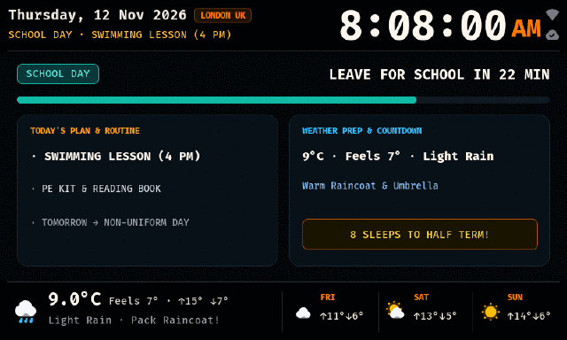
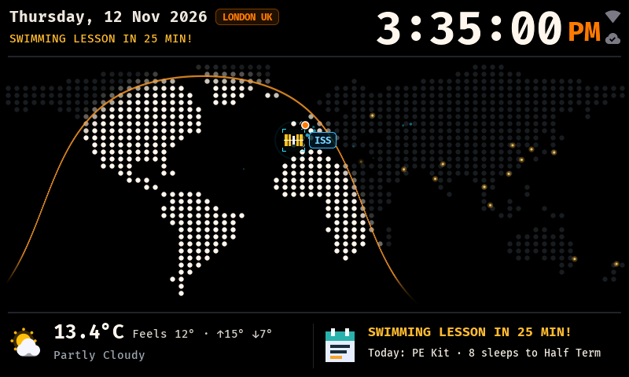
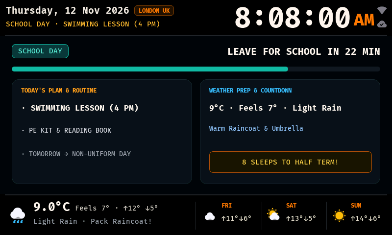
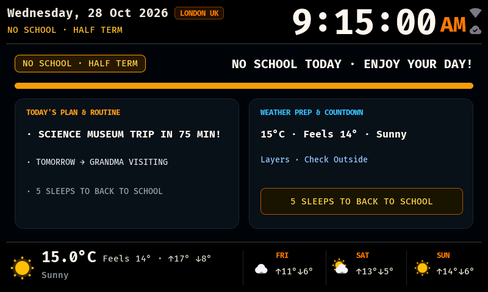
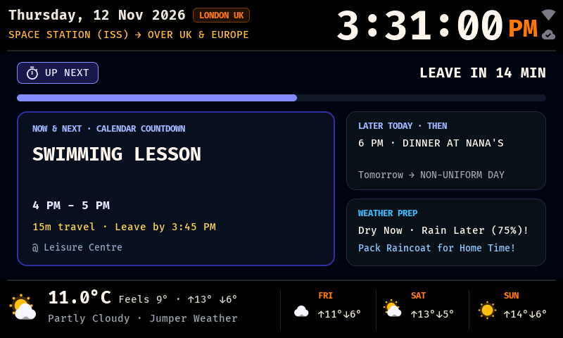
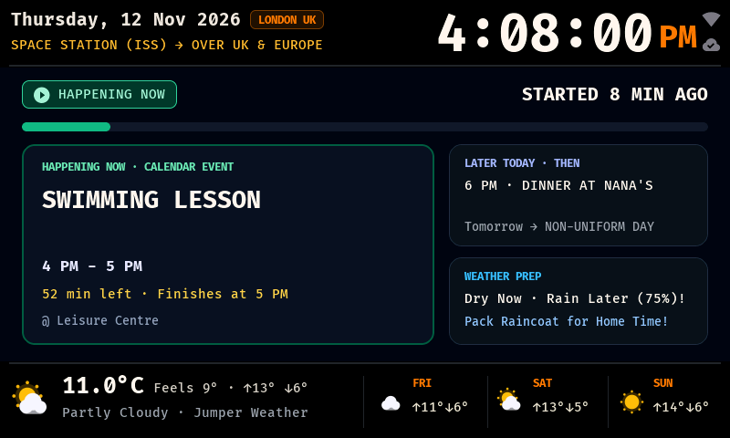
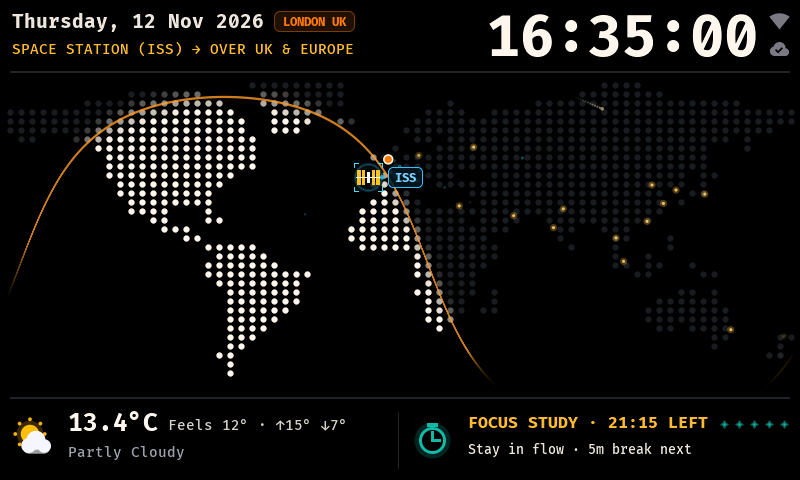

# Parent Guide — Setting Up & Customising Your World & Space Clock

This guide covers every setting on your clock's phone-friendly Web Settings page — **no apps, no accounts, and no technical tools required**.

---

## 1. Finding & Opening Your Clock's Settings

Every clock has its own unique address and password printed right on its boot screen:
1. Unplug the USB-C cable and plug it back in (or use your saved bookmark).
2. On first setup, scan the **Wi-Fi QR Code** on the screen with your phone camera (or join hotspot `world-clock-XXXXXX`, password `ClockSetup123`) to connect the clock to your home Wi-Fi.
3. Once connected, scan the **Settings QR Code** (or type `http://world-clock-XXXXXX.local/` into Safari/Chrome) and log in with:
   - **Username**: `parent`
   - **Password**: the **unique 8-character random password** displayed right on your clock's boot screen *(generated securely on first boot and saved automatically across updates!)*

> **Running multiple clocks in one home?** Each clock automatically gets its own unique `world-clock-XXXXXX.local` address and its own cryptographically random 8-character Web UI password, so sibling clocks never clash!
>
> **Sleep-Safe Red QR Code:** Even if the power briefly blinks at 2 AM, the boot screen uses dim **night-vision red-on-black** (zero blue/white light!) and automatically skips the 4-second info splash between 10 PM and 6 AM so it drops straight back into dim Red Sleep Mode.

---

## 2. Automatic Family & School Calendar Integration (Set Once, Never Touch Again!)

Instead of opening the clock's settings every week, you can link your existing **Apple iCloud**, **Google Calendar**, and/or **School Term Calendar** (on **both Standalone AND Home Assistant clocks**!). The clock checks them silently every 30 minutes in the background and turns your normal calendar into calm, predictable daily guidance — ideal for busy school mornings and neurodivergent / autistic children who love knowing exactly what's coming next!



### Choose Your Calendar Display Style
Pick how prominent you want your calendar to look under **Calendar Display Style**:

1. **Morning Launchpad Takeover** *(Default for Kids Profiles — Autism-Friendly Morning Overview)* — Starts at your **Morning Launchpad Start Time** (default `07:00`, and automatically waits until Wake-Up if Sleep/Quiet Play is still active!). On school days it stays on for your **Keep Launchpad After School Time** grace window (default `30 min` past `Leave for School Time`, e.g. `08:30 → 09:00` for busy mornings!). On **weekends & school holidays**, it stays open until your **Non-School Day Launchpad End Time** (default `10:30 AM`) so slow weekend mornings still show today's calm overview — automatically dropping expired timed events as the morning progresses!
   - Top **School Day** (teal) or **No School · Half Term** (warm amber) badge + live **"LEAVE FOR SCHOOL IN 22 MIN"** progress bar
   - **Today's Plan & Routine** (Parent Note, upcoming timed events, all-day items like PE Kit, and Tomorrow heads-up)
   - **Pack & Wear for Today (Whole-Day Briefing)** — Looks ahead at the **full day's forecast** rather than repeating the current weather below it: warns *"Dry Now · Rain Later (75%)! → Pack Warm Raincoat & Umbrella"* when rain is due by pickup, or *"Cool AM → Warm PM (↑23°C) → Layers: Jumper Now, T-Shirt Later"* on big morning-to-afternoon temperature swings!
   - **Automatic Holiday & Back-to-School Badge**: counts down **"8 SLEEPS TO HALF TERM!"** during term time and **"5 SLEEPS TO BACK TO SCHOOL"** during school holidays (automatically skipping Sat/Sun weekends!)
2. **Prominent Dock Card** — Keeps the full World Map & ISS visible, while turning the bottom-right dock card into a clean **"TODAY'S PLAN"** card with a live countdown for timed events (`"SWIMMING LESSON IN 25 MIN!"`):
   
3. **Subtle Ticker Only** *(Default for Teen & Study Desk)* — Keeps the full live World Map & 3-day forecast visible, rotating calm calendar headlines along the top ticker (`"SCHOOL DAY · SWIMMING LESSON (4 PM)"`).

| School Day Morning Launchpad | Half Term No-School Launchpad |
| :---: | :---: |
|  |  |

### Autism-Friendly "Now & Next" Event Countdown Takeover (iPhone Travel Time Ready!)
Whenever a timed event approaches during daytime, the clock automatically switches Band 2 to a visually distinct **Indigo / Violet "Now & Next" Countdown Board** (immediately distinguishable at a glance from the teal/amber Morning Launchpad!):
- **Configurable Calendar Source** (`Event Countdown Takeover Source`): Choose **Off**, **Family Only** *(default)*, **School Only**, or **Both Calendars**.
- **Configurable Lead-In & Post-Start Windows**: Shows **30 minutes before** (configurable `5–90 min`) and stays visible **30 minutes after start** (configurable `0–60 min`, automatically stopping early if a shorter event's `DTEND` finishes sooner!).
- **Native iPhone / iCloud Travel Time Support**: Automatically reads Apple Calendar's `X-APPLE-TRAVEL-DURATION` (or manual `[travel:15m]` tags for Google/School calendars!) and counts down to **Leave Time** first (`"LEAVE IN 14 MIN · 15m travel · Leave by 3:45 PM"`), switches to a calm coral **`TIME TO LEAVE`** window during travel (`"LEAVE NOW · STARTS IN 11 MIN"`), and transitions to a calm emerald **`HAPPENING NOW`** state (`"STARTED 8 MIN AGO"`).
- **Compact "Later Today · Then" + Weather Prep**: Keeps the focus on the single event in the wide hero card (with venue/location if set), paired with a smaller right-hand **"Later Today · Then"** preview (prioritising subsequent timed events) and **"Weather Prep"** reminder.
- **One-Tap Dismiss & Quiet Opt-Out**: Tap **Dismiss Active Event Board** in Home Assistant or Web UI to clear just the current event, or add `[quiet]` / `[hide]` to any adult calendar entry so it never takes over your child's screen.

| Event Countdown Takeover (15m Travel Time) | Event Takeover — Happening Now (Started 8m Ago) |
| :---: | :---: |
|  |  |

### Multi-Event Priority Engine (`Calendar Priority Mode`)
What happens when you have a timed event today, an all-day event today, AND multiple countdowns running at once?
- **Timed Events Automatically Count Down & Auto-Expire**: Within 90 minutes of start time, `"SWIMMING LESSON"` becomes `"SWIMMING LESSON IN 25 MIN!"` → `"SWIMMING LESSON NOW!"`, and automatically disappears 30 minutes after start time so stale morning events never clutter the afternoon!
- **3 Parent-Selectable Priority Modes**:
  - **`Smart Auto`** *(Recommended)*: Imminent timed events (within 90 min) take #1 priority; otherwise alternates calmly between Today's Routine, Priority `Countdown:` tags, Tomorrow's heads-up (from 3 PM), and automatic School Holiday countdowns.
  - **`Today & Routine First`**: Always leads with today's events & school status; saves countdowns for quiet days.
  - **`Countdowns First`**: Keeps upcoming holidays & trips front-and-center alongside imminent timed events.

### Why Are There Two Calendar URLs? (Family vs. School)
**Both calendars can display events on the screen** — they are merged automatically (with Family events taking priority if both have events at the same time). The key difference is how **School Holidays / No-School Days** are detected:

| Capability | **Family Calendar URL** | **School Term & Holiday Calendar URL** |
| :--- | :---: | :---: |
| Displays normal timed & all-day events (e.g. *Swimming*, *Christmas Dinner Day*, *School Photos*) | **Yes** (priority) | **Yes** (merged automatically!) |
| Triggers `NO SCHOOL` / Lie-In / Late Bedtime **from plain keywords** (*INSET, Half Term, Holiday, School Closed*) | **No** *(so adult work trips don't cancel school!)* | **Yes** (automatic — no tags needed!) |
| Triggers `NO SCHOOL` / Lie-In / Late Bedtime **with `[holiday]` or `[no school]` tag** | **Yes** | **Yes** |
| Enables the `SCHOOL DAY` badge on normal weekdays | Only during active holidays | **Yes** (every weekday) |
| Auto `"X SLEEPS TO HALF TERM!"` & `"X SLEEPS TO BACK TO SCHOOL"` countdowns | **Yes** (from `[holiday]` / `[no school]` events, merged seamlessly with School INSET days!) | **Yes** |

> **Tip if your school calendar only lists INSET days & school events (and not council term holidays):** Paste your school's HTTPS `.ics` link into **School Term & Holiday Calendar URL**, and add the ~6 term holiday blocks for the year into your **Family Calendar** with **`[holiday]`** in the title (e.g. `October Half Term [holiday]`). The clock automatically merges both feeds — so if Half Term ends Friday and the school feed has a Monday `INSET` day, it counts all the way to Tuesday!

### Helpful Event Tags You Can Use Right in Apple/Google Calendar
- **`Countdown:` or `[countdown]`** *(up to 90 days ahead!)* — e.g. `Countdown: Cornwall Holiday` or `Disney Trip [countdown]`. The clock strips the tag cleanly and prioritizes up to 2 concurrent countdowns (`"42 SLEEPS TO CORNWALL HOLIDAY!"`).
- **`[no school]` or `[holiday]`** — Add this to any Family Calendar event (or link your School's `.ics` feed, which auto-detects *Holiday, Half Term, Inset, Training Day, Teacher Day, Closed, Bank Holiday, No School*) to trigger **NO SCHOOL** badges, **Morning Lie-In**, and **Non-School Night Late Bedtime** automatically!
- **`[travel:15m]`** — Optional manual travel-time tag for Google Calendar or school events (Apple iPhone Calendar's built-in **Travel Time** field is read automatically with no tag needed!).
- **`[quiet]` or `[hide]`** — Prevents background/adult timed events (e.g., `Boiler Service [quiet]`) from triggering the full-screen Event Countdown Takeover Board.

### Step-by-Step: Getting Your Calendar Link

#### Apple iPhone / iCloud Calendar
1. Open the **Calendar** app on your iPhone/iPad.
2. Tap **Calendars** at the bottom. *(Tip: create a dedicated "Leo" or "Family Kids" calendar so work meetings don't appear on the clock!)*
3. Tap the **`(i)`** button next to that calendar.
4. Toggle **Public Calendar** ON, tap **Share Link...**, and tap **Copy**.
5. Open your clock's Web Settings → **5. Family & School Calendar (.ics)** → paste the link directly into **Family Calendar URL** *(you can paste `webcal://...` directly — the clock handles it automatically!)*.

#### Google Calendar
1. Open [calendar.google.com](https://calendar.google.com) on a browser (or desktop mode on phone).
2. Click the **3 dots** next to your family calendar → **Settings and sharing**.
3. Scroll to **Integrate calendar** and copy **Secret address in iCal format** (`https://calendar.google.com/.../basic.ics`).
4. Paste it into **Family Calendar URL** on your clock.

#### School Term Dates Calendar
1. Check your school's website calendar page for a **"Subscribe"**, **"iCal"**, or **"Add to Calendar"** link (`webcal://...` or `https://...ics`).
2. Copy that link and paste it into **School Term & Holiday Calendar URL** on your clock!
3. Tap **Sync Weather, ISS & Calendars Now** in Quick Controls to test immediately.

---

## 3. All Web Settings Explained

### 1. Quick Controls & Overrides
- **Occasion & Preview Mode**: Test any holiday, sleep phase, **Morning Launchpad Preview**, **No-School Holiday Preview**, or **Focus Study Timer Preview** right away (automatically reverts to `Auto` after 10 minutes so you can't forget!).
- **Age & Visual Profile (Ages 3–16+)**: One-tap preset tailored to your child's age:
  - **Little Explorer (3–6)**: 12h clock, full 4-phase sleep trainer, 5 countdown stars, all holidays.
  - **Junior Space Kid (7–11)**: 12h clock, World Map, ISS tracker, Morning Launchpad, holidays & sleep trainer.
  - **Teen & Study Desk (12+)**: Clean 24-hour desk clock, World Map, ISS, Calendar & **Focus Pomodoro Study Timer** (turns off kiddie holidays & sleep trainer cards automatically!):
    
- **Focus Pomodoro Study Timer (`Start 25m Focus Study` / `Start 5m Focus Break` / `Stop Focus Timer`)**: Turns the bottom-right dock into a live `MM:SS` focus/break countdown with 5 glowing teal progress stars — great for homework, reading, or GCSE revision!
- **Screen Backlight**: Manual override slider if you want to brighten/dim temporarily.
- **Message of the Day (Auto-Clears at Midnight)**: Type a one-off reminder like `"PE kit today!"` or `"Grandma picking up!"` — shows right at the top until midnight or cleared.
- **Tooth Fairy Tonight!**: One-tap toggle for when a tooth falls out! Turns Evening Wind-Down into a magical twinkling tooth card (`"SHHH... TOOTH FAIRY TONIGHT!"`) with floating golden fairy dust on the map, and turns itself back off at noon the next day.
- **Nap Timer Duration + Start Nap Mode Now**: Instantly puts the clock into soft Red Nap Mode with fading countdown stars for 15–180 minutes, then returns to normal automatically.
- **Trigger Wind-Down Now / Cancel Override**: Start Amber Wind-Down early on tired evenings without editing your regular bedtime.
- **Shop & Fayre Demo Mode**: Cycles through every operational mode every 10 seconds for live demonstrations (always resets to OFF on reboot).

### 2. Child Profile, Location & Units
- **Child Name & Birth Date**: Personalizes morning greetings, birthday age & countdowns.
- **Location Pill Label + Latitude & Longitude**: Sets the home pin on the world map and fetches hyper-local weather & 3-day forecasts. *(Tip: find coordinates on Google Maps by long-pressing your town.)*
- **Timezone**: Pick from 12 worldwide timezones (automatic daylight saving!).
- **24-Hour Clock / Fahrenheit (`°F`) / Miles**: Instant switch for UK, European, or US families.

### 3. Sleep Schedule & Brightness
Every phase can be turned **ON or OFF** independently:
1. **Evening Wind-Down (Amber)** — *"Get ready for bed!"* (sunset + crescent icon)
2. **Deep Sleep (Red)** — Night-vision dim red with tonight's **real lunar phase** moon
3. **Morning Quiet Play (Amber)** — Rising-sun icon (*"OK to play quietly in your room"*)
4. **Morning Wake-Up (Daytime)** — Full bright World Map, Weather & ISS Tracker
- **5 Sleep Countdown Stars**: Toggleable row of 5 glowing stars during Wind-Down, Sleep, and Naps that gently fade out one by one so younger children can see how long is left without reading digital numbers.
- **Weekend & School-Holiday Lie-In (Morning)**: Optional +5 to +90 minute shift for **Quiet Play** and **Wake-Up** whenever **TODAY** is Saturday, Sunday, or a School Holiday / Inset Day.
- **Symmetric Non-School Night Late Bedtime (Evening)**: Optional +5 to +90 minute shift for **Evening Wind-Down** and **Bedtime** whenever **TOMORROW** is a non-school day!
  - **Friday & Saturday nights** (or the night before a Monday Inset Day / Half Term) → automatically shift bedtime later!
  - **Sunday nights before Monday school** → automatically return to the early school-night bedtime so Monday mornings stay smooth!
- **4 Brightness Sliders**: Independent brightness for Day, Wind-Down, Quiet Play, and Deep Sleep.

### 4. Custom Screen Wording (`{tokens}`)
Personalize any ticker or card message! Use these dynamic placeholders so changing a schedule time automatically updates every message:
- `{name}` → Child's name (e.g. `LEO`)
- `{winddown}` → Wind-down time (e.g. `7 PM`)
- `{bedtime}` → Bedtime (e.g. `7:30 PM`)
- `{quiet}` → Effective quiet-play time (automatically reflects Weekend Lie-In!)
- `{wakeup}` → Effective wake-up time

### 5. Family & School Calendar (.ics) & Custom Countdown
- **Family Calendar URL** & **School Calendar URL** (see Section 2 above)
- **Custom Countdown Name & Date**: Quick built-in countdown without needing a calendar (e.g., `CORNWALL` / `2026-08-01` → `"14 SLEEPS TO CORNWALL!"`).

### 6. Occasions & Visual Features
- Toggle **Night-Side City Lights**, **Live ISS Space Station Tracker** (with overhead *"WAVE AT ASTRONAUTS!"* alerts & occasional shooting stars / Perseids & Geminids meteor showers), **Seasonal Holidays** (Birthday, Christmas Advent, Santa Tracker, Christmas Day, Halloween, Easter Egg Hunt, Bonfire/NYE Fireworks, Star Wars Day, Pancake Day, Mother's Day, Father's Day, World Book Day, Solstices), **Keep Santa Flying During Xmas Eve Wind-Down**, and **Special Nights Bedtime Delay** (0–120 min shift on Christmas Eve, NYE & Bonfire Night).

---

## 4. Wireless Firmware Updates (No Computer Needed!)

1. Download the latest **`world-clock-standalone-vX.Y.Z-ota.bin`** file from the GitHub Releases page onto your phone or laptop.
2. Open your clock's Web Settings (`http://world-clock-XXXXXX.local/`).
3. Scroll to **OTA Update**, tap **Choose File**, select the `-ota.bin` file, and tap **Update**.
4. Keep power connected for ~30 seconds — your Wi-Fi, child's profile, calendars, and sleep schedule are all preserved automatically!

---

## 5. Home Assistant Calendar Setup (For HA Users)

### Option A (Recommended — Zero Home Assistant Calendar Setup!)
Kids/Teen Home Assistant clocks (`packages/backend_homeassistant.yaml` + `packages/ha_kids_calendar.yaml`) include the **exact same built-in Core 0 HTTPS `.ics` / `webcal://` calendar engine** (and calendar URL fields are password-masked so secret links stay private!):
1. Open your clock's device page in Home Assistant (**Settings → Devices & Services → ESPHome → your clock**).
2. Paste your Apple iCloud (`webcal://...`) or Google `.ics` link (`https://...`) directly into **Family Calendar URL** and/or **School Term & Holiday Calendar URL**.
3. Pick your **Calendar Display Style** (`Subtle Ticker Only`, `Prominent Dock Card`, or `Morning Launchpad Takeover`), **Calendar Priority Mode**, and **Leave for School Time** — and press **Sync Calendars Now**!

*(Adult/Office Energy clocks omit `packages/ha_kids_calendar.yaml`, keeping Home Assistant free of kids/school entities and saving RAM/CPU.)*

### Option B (Optional — Home Assistant Template Sensors)
If you prefer feeding events from local Home Assistant `calendar.*` entities instead of `.ics` URLs, include `packages/ha_calendar_sensors.yaml` and add this snippet to Home Assistant's `configuration.yaml`:

```yaml
template:
  - trigger:
      - platform: time_pattern
        minutes: "/15"
      - platform: homeassistant
        event: start
    action:
      - action: calendar.get_events
        target:
          entity_id:
            - calendar.family
            - calendar.school
        data:
          duration:
            hours: 48
        response_variable: cal
    sensor:
      - name: "Clock Calendar Today"
        state: >-
          {% set today = now().strftime('%Y-%m-%d') %}
          
          {{ evs[0].summary if evs else 'none' }}
      - name: "Clock Calendar Tomorrow"
        state: >-
          {% set tmrw = (now() + timedelta(days=1)).strftime('%Y-%m-%d') %}
          
          {{ evs[0].summary if evs else 'none' }}
      - name: "Clock School Note"
        state: >-
          {% set today = now().strftime('%Y-%m-%d') %}
          
          {{ evs[0].summary if evs else 'none' }}
    binary_sensor:
      - name: "Clock School Holiday"
        state: >-
          {% set today = now().strftime('%Y-%m-%d') %}
          
          {{ 'holiday' in evs or 'half term' in evs or 'inset' in evs or 'closed' in evs or 'no school' in evs }}
```
